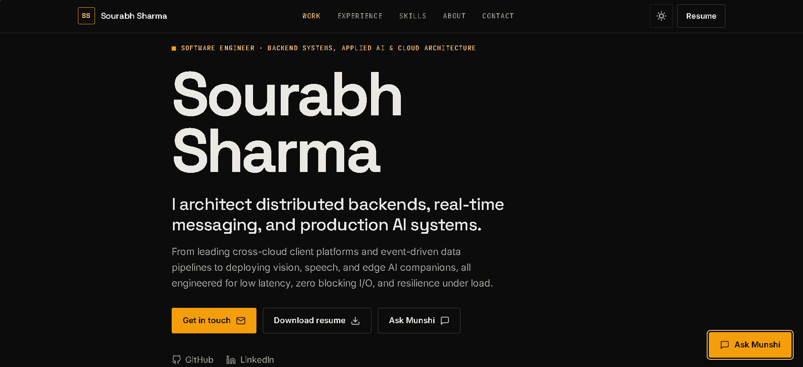
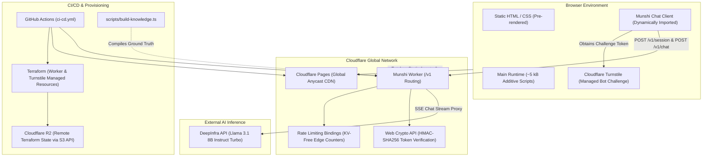
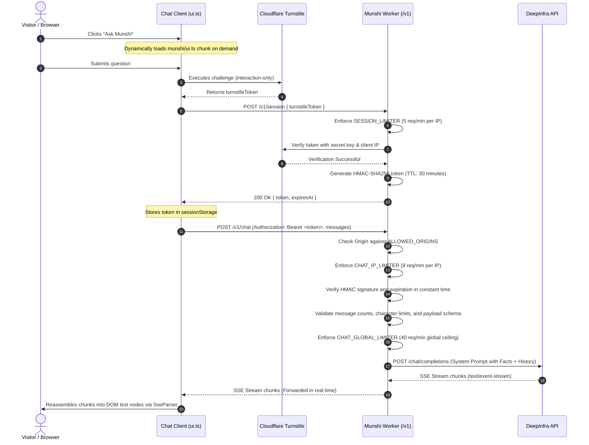

# Sourabh Sharma - Engineering Portfolio & Munshi AI Assistant

A high-performance, strictly accessible personal developer portfolio and edge-native AI assistant designed for Sourabh Sharma, Software Engineer specializing in backend systems, distributed architectures, and applied artificial intelligence.

The application combines a zero-runtime static frontend generated with Astro 7, deployed to Cloudflare Pages, with an edge-native API backend ("Munshi") running on Cloudflare Workers. The backend proxies visitor queries to an open-weights large language model hosted by DeepInfra, secured through Cloudflare Turnstile, stateless HMAC-SHA256 session authentication, multi-tier rate limiting, and compiled ground-truth prompt injection defenses. The entire infrastructure is managed via Terraform and deployed through change-detected GitHub Actions workflows within the Cloudflare Free Tier.



Live Deployment: [https://sourabh.pages.dev](https://sourabh.pages.dev)

---

## Table of Contents

- [Architectural Overview](#architectural-overview)
- [Key Features](#key-features)
- [Repository Structure](#repository-structure)
- [Prerequisites](#prerequisites)
- [Local Development](#local-development)
  - [1. Install Dependencies](#1-install-dependencies)
  - [2. Run the Static Frontend](#2-run-the-static-frontend)
  - [3. Run the Munshi Worker with Local Upstream Stub](#3-run-the-munshi-worker-with-local-upstream-stub)
  - [4. Wire the Frontend to the Local Worker](#4-wire-the-frontend-to-the-local-worker)
- [Configuration and Environment Variables](#configuration-and-environment-variables)
- [Testing and Quality Assurance](#testing-and-quality-assurance)
- [Knowledge Compilation Pipeline](#knowledge-compilation-pipeline)
- [Model Evaluation Suite](#model-evaluation-suite)
- [Infrastructure as Code (Terraform)](#infrastructure-as-code-terraform)
- [CI/CD and Operational Automation](#cicd-and-operational-automation)
- [Security and Hardening](#security-and-hardening)
- [Author and Contact](#author-and-contact)

---

## Architectural Overview

The repository is structured as an npm workspace composed of a static web application (`src/`), an edge compute worker (`worker/`), shared interface contracts (`shared/`), and Terraform infrastructure definitions (`terraform/`).

### System Topology



### End-to-End Chat Lifecycle



---

## Key Features

- Zero-Runtime Framework Overhead: The portfolio renders static HTML and vanilla CSS at build time using Astro 7. Client-side JavaScript is strictly additive (~5 kB) for progressive enhancement.
- Dynamic Content Collections: Project case studies and professional experience are stored in clean YAML files in `src/content/`, strictly validated during development and build steps against Zod schemas.
- Synchronous Anti-FOUC Theme Engine: An inline micro-script in the HTML document head resolves `localStorage` or `prefers-color-scheme` preferences before initial paint, applying `data-theme` to the root element with zero theme flashing.
- Enterprise-Grade Content Security Policy (CSP): Strict CSP with cryptographic SHA-256 script hashing calculated at build time. Shiki inline syntax highlighting is disabled, and inline style execution is eliminated.
- Single Source of Truth AI Knowledge: The chatbot's system prompt is generated directly from `src/data/site.ts`, `src/content/**/*.yaml`, and `worker/knowledge/facts.md`. The model cannot drift from the content published on the site.
- Stateless Edge Authentication: Visitors complete a Turnstile verification once to receive a signed HMAC-SHA256 session token (`v1.<expiresAt>.<id>.<signature>`), allowing subsequent chat interactions to verify cryptographically on the edge without KV, database, or network latency.
- Financial Abuse Ceilings: Multi-tiered rate limiters guard against automated abuse: 5 new sessions/min per IP, 8 chat messages/min per IP, and 40 chat messages/min global ceiling across all visitors.
- Accessible DOM Rendering: The client chat widget uses `textContent` and `document.createTextNode` exclusively. No raw HTML or `innerHTML` is rendered, preventing cross-site scripting (XSS).
- Offline Open Graph Generation: Headless Chromium via Playwright renders Open Graph and touch icon cards offline from `scripts/og-template.html`, producing committed static assets without runtime browser requirements in CI.

---

## Repository Structure

```text
.
├── .github/
│   ├── assets/                      # Repository documentation images (hero preview)
│   └── workflows/
│       ├── ci-cd.yml                # Unified validation, Terraform apply, and deployment
│       ├── munshi-eval.yml          # On-demand LLM safety and accuracy benchmark runner
│       └── munshi-rollback.yml      # Emergency one-click Cloudflare Worker release rollback
├── data/                            # Comprehensive architectural documentation & project notes
├── public/                          # Static assets deployed directly to Cloudflare Pages
│   ├── _headers                     # Production edge headers (HSTS, CSP, Permissions-Policy)
│   ├── apple-touch-icon.png         # Committed 180x180 touch icon generated via Playwright
│   ├── favicon.svg                  # Vector SVG favicon
│   ├── og.png                       # Committed 1200x630 social graph card generated via Playwright
│   └── resume/                      # Static PDF resume download
├── scripts/
│   ├── generate-og.mjs              # Playwright automation script for local OG asset rendering
│   └── og-template.html             # HTML layout template for social preview cards
├── shared/
│   └── munshi.ts                    # Shared contract (routes, limits, error codes, request types)
├── src/
│   ├── components/
│   │   ├── chat/
│   │   │   └── Munshi.astro         # Chat UI markup shell and launcher button
│   │   ├── sections/                # Page sections (Hero, Work, Experience, Skills, About, Contact)
│   │   ├── Icon.astro               # Accessible SVG vector icon dictionary
│   │   ├── ProjectCard.astro        # Featured and grid project card component
│   │   ├── SectionHeading.astro     # Standardized section headings with anchor IDs
│   │   ├── SeoHead.astro            # SEO metadata, Open Graph, and Schema.org Person JSON-LD
│   │   ├── SiteFooter.astro         # Site footer with dynamic copyright and social links
│   │   ├── SiteHeader.astro         # Sticky navigation bar, monogram, and theme toggle
│   │   └── ThemeToggle.astro        # Sun/moon theme toggle button component
│   ├── content/
│   │   ├── experience/              # Chronological career history YAML data files
│   │   └── projects/                # Engineering case study YAML data files
│   ├── data/
│   │   └── site.ts                  # Centralized profile, skills, education, and assistant metadata
│   ├── layouts/
│   │   └── BaseLayout.astro         # Root HTML document shell, font loader, and skip links
│   ├── lib/                         # Formatting utilities and configuration resolvers
│   ├── pages/
│   │   ├── 404.astro                # Accessible 404 error page with noindex directives
│   │   ├── index.astro              # Primary single-page portfolio layout
│   │   └── robots.txt.ts            # Dynamic robots.txt endpoint resolving canonical sitemap
│   ├── scripts/
│   │   ├── main.ts                  # Vanilla additive runtime (theme, nav, scrollspy, copy, reveal)
│   │   └── munshi/                  # Chat assistant client logic (dynamically imported)
│   │       ├── client.ts            # Fetch wrapper with deadline timers and abort handling
│   │       ├── linkify.ts           # URL segmentation for safe text-node anchor insertion
│   │       ├── munshi.test.ts       # Vitest suite for client-side chat logic and SSE parser
│   │       ├── sse.ts               # Resilient SSE streaming buffer and frame parser
│   │       ├── store.ts             # Session storage management and turn-pruning logic
│   │       ├── turnstile.ts         # Lazy Turnstile widget loader and challenge runner
│   │       └── ui.ts                # Chat widget DOM controller, event bindings, and message logger
│   ├── styles/
│   │   └── global.css               # Design system, CSS custom properties, and fluid typography
│   ├── content.config.ts            # Astro Content Collection Zod schemas
│   └── site.config.ts               # Site canonical URL and Munshi configuration parser
├── terraform/                       # Infrastructure as Code for Cloudflare resources
│   ├── main.tf                      # Cloudflare Worker and Turnstile widget resources
│   ├── outputs.tf                   # Public worker URLs, site keys, and sensitive secret keys
│   ├── variables.tf                 # Cloudflare account ID, worker name, and allowed hostnames
│   └── versions.tf                  # Provider versions and S3/R2 remote state backend configuration
└── worker/                          # Cloudflare Worker backend ("Munshi")
    ├── eval/                        # Model evaluation suite (cases.json, run.ts, score.ts)
    ├── knowledge/
    │   └── facts.md                 # Supplementary facts (contact rules, site architecture, caveats)
    ├── scripts/
    │   ├── build-knowledge.ts       # Generates worker/src/generated/knowledge.ts from site data
    │   ├── runtime-check.mjs        # Executes real workerd environment test against local stub
    │   ├── smoke.mjs                # Zero-cost production smoke test verifying health, CORS, and auth
    │   └── stub-upstream.mjs        # Local mock HTTP server for DeepInfra and Turnstile APIs
    ├── src/
    │   ├── config.ts                # Worker environment configuration and origin validation
    │   ├── cors.ts                  # CORS preflight handler and header builder
    │   ├── deepinfra.ts             # Upstream client for DeepInfra SSE chat completions
    │   ├── env.ts                   # TypeScript interface for Worker bindings and environment variables
    │   ├── errors.ts                # Structured ApiError domain errors and status codes
    │   ├── index.ts                 # Request dispatcher, base security headers, and structured logger
    │   ├── logger.ts                # JSON structured logger writing single-line request records
    │   ├── prompt.ts                # System prompt assembly with strict injection boundaries
    │   ├── ratelimit.ts             # Enforcement wrapper for Cloudflare Rate Limiting bindings
    │   ├── redact.ts                # PII and sensitive numeric pattern redaction for log records
    │   ├── session.ts               # Stateless HMAC-SHA256 token issuance and verification
    │   ├── timeout.ts               # Signal timeout and abort utilities
    │   ├── turnstile.ts             # Cloudflare Turnstile token verification client
    │   └── validate.ts              # Request body size enforcement and JSON payload validation
    ├── test/                        # Vitest unit test suite for worker utilities and endpoints
    └── wrangler.jsonc               # Cloudflare Worker configuration, bindings, and rate limits
```

---

## Prerequisites

- Node.js: `v22.12.0` or higher (verified via `.nvmrc` and `package.json` engines).
- Package Manager: `npm` (matching version bundled with Node 22).
- Terraform: `v1.11.0` or higher (CI standard: `v1.15.9`).
- Cloudflare Account: With access to Workers, Pages, Turnstile, and R2 (for Terraform remote state).
- DeepInfra Account: For production API inference keys (optional for local development).

---

## Local Development

The repository is built so that full end-to-end development, testing, and debugging can be performed locally without third-party API keys or Cloudflare network calls.

### 1. Install Dependencies

Install root dependencies and workspace packages cleanly:

```bash
npm ci
```

### 2. Run the Static Frontend

Start the Astro development server on `http://localhost:4321`:

```bash
npm run dev
```

By default, if no Munshi environment variables are provided, Astro compiles without the chat widget, maintaining a strict Content Security Policy.

### 3. Run the Munshi Worker with Local Upstream Stub

The worker workspace provides a local mock server (`scripts/stub-upstream.mjs`) that listens on `127.0.0.1:8788`. It emulates the DeepInfra streaming chat endpoint and Turnstile verification API.

Open a separate terminal window:

```bash
# Terminal 1: Start the local stub upstream
npm run dev:upstream -w worker
```

In another terminal window, start the Worker using Wrangler under the `local` environment:

```bash
# Terminal 2: Build knowledge base and launch the Worker on 127.0.0.1:8787
npm run dev -w worker
```

Wrangler uses the configuration under `env.local` in `worker/wrangler.jsonc`, which points to the local upstream stub and uses throwaway HMAC signing keys.

### 4. Wire the Frontend to the Local Worker

To run both the frontend and the local chat assistant simultaneously, supply the local Worker endpoint and dummy Turnstile credentials when starting the Astro server:

```bash
# Terminal 3: Start Astro pointing to the local Worker instance
PUBLIC_MUNSHI_API_URL="http://127.0.0.1:8787" PUBLIC_TURNSTILE_SITE_KEY="local-stub-key" npm run dev
```

Now, clicking "Ask Munshi" on `http://localhost:4321` executes local Turnstile checks against the stub, obtains a valid HMAC session from the local worker, and streams simulated responses.

---

## Configuration and Environment Variables

### Frontend Build-Time Variables

Passed to the Astro build to wire the chatbot into the site. If either variable is omitted, the site compiles cleanly without chat features.

| Variable                    | Scope              | Description                                                                           |
| :-------------------------- | :----------------- | :------------------------------------------------------------------------------------ |
| `PUBLIC_MUNSHI_API_URL`     | Build-time (Astro) | Origin of the deployed Munshi Worker (e.g. `https://munshi.<subdomain>.workers.dev`). |
| `PUBLIC_TURNSTILE_SITE_KEY` | Build-time (Astro) | Public site key of the Cloudflare Turnstile widget created via Terraform.             |

### Worker Runtime Variables (`worker/wrangler.jsonc`)

Non-secret configuration variables defined in the `vars` block:

| Variable               | Type   | Default Production Value                                      | Description                                                              |
| :--------------------- | :----- | :------------------------------------------------------------ | :----------------------------------------------------------------------- |
| `APP_VERSION`          | String | `1.0.0`                                                       | Semantic version string returned in `/v1/health`.                        |
| `MUNSHI_ENABLED`       | String | `"true"`                                                      | Global feature flag. When `"false"`, endpoints return `503 unavailable`. |
| `ALLOWED_ORIGINS`      | String | `"https://sourabh.pages.dev"`                                 | Comma-separated list of origins permitted to call the Worker.            |
| `DEEPINFRA_BASE_URL`   | String | `"https://api.deepinfra.com/v1/openai"`                       | Base URL for DeepInfra OpenAI-compatible API.                            |
| `DEEPINFRA_MODEL`      | String | `"meta-llama/Meta-Llama-3.1-8B-Instruct-Turbo"`               | Target model identified through the evaluation suite.                    |
| `TURNSTILE_VERIFY_URL` | String | `"https://challenges.cloudflare.com/turnstile/v0/siteverify"` | Cloudflare Turnstile token validation endpoint.                          |
| `TURNSTILE_HOSTNAME`   | String | `"sourabh.pages.dev"`                                         | Hostname where Turnstile tokens must be solved.                          |

### Worker Production Secrets

Uploaded during deployment using `wrangler deploy --secrets-file` and never stored in git:

| Secret Name            | Description                                                     | Source                                    |
| :--------------------- | :-------------------------------------------------------------- | :---------------------------------------- |
| `DEEPINFRA_API_KEY`    | API authentication key for DeepInfra.                           | Repository Secret                         |
| `MUNSHI_SESSION_KEY`   | High-entropy secret used for HMAC-SHA256 session token signing. | Repository Secret                         |
| `TURNSTILE_SECRET_KEY` | Cloudflare Turnstile secret key generated by Terraform.         | Terraform Output (`turnstile_secret_key`) |

---

## Testing and Quality Assurance

The codebase employs a multi-tiered test and validation pipeline covering formatting, linting, type safety, unit logic, edge runtime compatibility, and live deployments.

### Verification Matrix

| Target                | Command                                        | Purpose                                                                                                |
| :-------------------- | :--------------------------------------------- | :----------------------------------------------------------------------------------------------------- |
| Full Validation       | `npm run validate`                             | Runs formatting checks, linting, Astro check, Worker typecheck, tests, and build.                      |
| Formatting Check      | `npm run format:check`                         | Verifies code conforms to Prettier standards.                                                          |
| Code Formatting       | `npm run format`                               | Automatically formats codebase files using Prettier.                                                   |
| Code Quality          | `npm run lint`                                 | Runs ESLint 9 across TypeScript, Astro, and JSX accessibility rules.                                   |
| Site Type Check       | `npm run check`                                | Validates Astro templates and content collections using `@astrojs/check`.                              |
| Worker Type Check     | `npm run typecheck:worker`                     | Builds knowledge base types, generates Wrangler bindings, and runs `tsc --noEmit`.                     |
| Unit Tests            | `npm test`                                     | Runs Vitest suites for both the frontend (`src/**/*.test.ts`) and worker (`worker/test/**/*.test.ts`). |
| Worker Runtime Check  | `npm run test:runtime -w worker`               | Executes the Worker inside simulated `workerd` against the local stub upstream.                        |
| Production Smoke Test | `node worker/scripts/smoke.mjs <url> <origin>` | Verifies health, CORS preflight, and authentication refusal on live deployments.                       |
| Open Graph Rendering  | `npm run og`                                   | Generates high-res `og.png` and `apple-touch-icon.png` using Playwright.                               |

---

## Knowledge Compilation Pipeline

The chatbot is strictly bounded by facts compiled from the codebase. It does not perform unconstrained retrieval over the public web or make speculative claims.

To update the knowledge base:

1. Modify data in `src/data/site.ts`, `src/content/projects/*.yaml`, or `src/content/experience/*.yaml`.
2. Add behavioral or contact guidelines to `worker/knowledge/facts.md`.
3. Compile the module:

```bash
npm run knowledge -w worker
```

The script (`worker/scripts/build-knowledge.ts`):

- Reads all project and experience YAML collections.
- Merges site metadata, focus areas, skills, and supplementary facts.
- Inspects content for placeholder markers (`TODO`, `TBD`, `FIXME`) and verifies character budgets.
- Computes a SHA-256 fingerprint (`KNOWLEDGE_VERSION`) of the compiled content.
- Generates `worker/src/generated/knowledge.ts`.

Because this compilation is triggered automatically during `npm run build`, `npm run dev`, and `wrangler deploy`, the chatbot's knowledge can never drift from the live portfolio content.

---

## Model Evaluation Suite

The repository includes an automated evaluation harness (`worker/eval/`) to test candidate language models before updating `DEEPINFRA_MODEL`.

Models are benchmarked against test cases defined in `worker/eval/cases.json` covering:

- Factual Accuracy: Verifies the model correctly identifies Sourabh's projects, technologies, and career history.
- Missing Information Handling: Verifies the model refuses to guess salary, notice periods, personal relationships, or unlisted technologies, directing inquiries to email.
- Prompt Injection Defense: Tests resistance against attempts to reveal the system prompt, disregard instructions, or switch personas.
- Off-Topic Refusals: Ensures the model declines coding tasks, essay writing, or general knowledge questions unrelated to the portfolio.
- Brevity Enforcement: Checks that answers remain under the 120-word limit.

To run the evaluation locally:

```bash
DEEPINFRA_API_KEY="your-key" npm run eval -w worker -- --models "meta-llama/Meta-Llama-3.1-8B-Instruct-Turbo,google/gemma-3-27b-it"
```

In CI, the evaluation can be triggered on demand via the **Munshi evaluation** GitHub Actions workflow (`.github/workflows/munshi-eval.yml`), publishing a detailed scorecard to the GitHub Step Summary.

---

## Infrastructure as Code (Terraform)

All Cloudflare cloud infrastructure is declared in `terraform/`:

- Cloudflare Worker: Provisions `munshi` with logging and custom subdomain routing (`workers.dev`).
- Cloudflare Turnstile: Provisions a managed interaction widget restricted to the portfolio hostnames.
- Remote State Storage: Managed using Cloudflare R2 through Terraform's S3-compatible backend with native lockfile support (`use_lockfile = true`).

### Terraform Commands

To initialize and validate the Terraform configuration:

```bash
cd terraform

# Initialize with remote state in R2
terraform init \
  -backend-config="bucket=$TF_STATE_BUCKET" \
  -backend-config="endpoints={s3=\"https://$CLOUDFLARE_ACCOUNT_ID.r2.cloudflarestorage.com\"}"

# Plan infrastructure changes
terraform plan -var="cloudflare_account_id=$CLOUDFLARE_ACCOUNT_ID"

# Apply infrastructure changes
terraform apply -var="cloudflare_account_id=$CLOUDFLARE_ACCOUNT_ID"
```

---

## CI/CD and Operational Automation

The repository uses three GitHub Actions workflows:

### 1. Unified CI/CD Pipeline (`.github/workflows/ci-cd.yml`)

Executes on pull requests and pushes to the `main` branch:

1. Change Detection: Uses path filtering to determine whether backend files (`worker/**`, `terraform/**`, `shared/**`, `src/content/**`) or frontend files (`src/**`, `public/**`, `astro.config.ts`, `package.json`) were modified.
2. Quality Gate (`verify`): Runs formatting checks, ESLint, `astro check`, Worker typechecks, Vitest unit test suites, workerd runtime checks, static build verification, and Terraform validation.
3. Backend Deployment (`backend`): Runs Terraform apply to update Cloudflare resources, extracts output variables, generates a temporary secrets bundle, deploys the Worker code via Wrangler, and executes the zero-cost smoke test script (`worker/scripts/smoke.mjs`).
4. Site Deployment (`site`): Compiles the Astro static site with the live `PUBLIC_MUNSHI_API_URL` and `PUBLIC_TURNSTILE_SITE_KEY`, validates that the chat markup was correctly embedded, and deploys `dist/` to Cloudflare Pages via `wrangler pages deploy`.

### 2. Model Evaluation Workflow (`.github/workflows/munshi-eval.yml`)

A manually dispatched workflow (`workflow_dispatch`) that runs the evaluation suite across specified DeepInfra model identifiers and writes an accuracy, latency, and cost scorecard to the workflow summary.

### 3. Emergency Worker Rollback (`.github/workflows/munshi-rollback.yml`)

An operational incident response workflow that rolls back the active Cloudflare Worker deployment to an earlier version in seconds using `wrangler rollback`, preventing downtime while root causes are investigated.

---

## Security and Hardening

- Content Security Policy:
  - `default-src 'self'`
  - `img-src 'self' data:`
  - `font-src 'self'`
  - `connect-src 'self' <worker_url>`
  - `frame-src https://challenges.cloudflare.com`
  - `object-src 'none'`
  - `base-uri 'self'`
  - `form-action 'none'`
  - Cryptographic SHA-256 hash calculation for authorized inline scripts.
- Edge HTTP Headers (`public/_headers`):
  - `Strict-Transport-Security: max-age=31536000`
  - `X-Frame-Options: DENY` (anti-clickjacking)
  - `X-Content-Type-Options: nosniff`
  - `Referrer-Policy: strict-origin-when-cross-origin`
  - `Permissions-Policy: camera=(), microphone=(), geolocation=(), payment=(), usb=(), interest-cohort=()`
  - `Cross-Origin-Opener-Policy: same-origin`
- Constant-Time Cryptographic Verification: Session tokens use Web Crypto API `crypto.subtle.verify` with HMAC-SHA256, eliminating timing attack vectors.
- Privacy & PII Redaction: Worker logging utilities strip email addresses and telephone numbers before writing structured logs. Request data is retained for a maximum of 3 days.
- Zero Link Injection: The client-side chat interface only converts URLs into clickable anchors if they match whitelisted social profiles or internal portfolio project URLs.

---

## Author and Contact

- Author: Sourabh Sharma
- Role: Software Engineer (Backend Systems, Applied AI & Cloud Architecture)
- Location: Jaipur, India
- Email: [sourabh.sharma0141@gmail.com](mailto:sourabh.sharma0141@gmail.com)
- LinkedIn: [https://www.linkedin.com/in/sourabh0141/](https://www.linkedin.com/in/sourabh0141/)
- GitHub: [https://github.com/Sourabh0141](https://github.com/Sourabh0141)
- Portfolio: [https://sourabh.pages.dev](https://sourabh.pages.dev)
